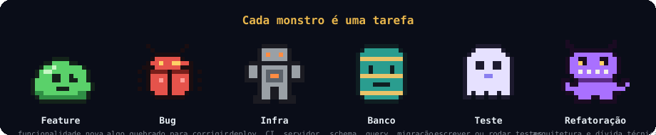

<p align="center">
  
</p>

<h1 align="center">Agent Arena</h1>

<p align="center">
  <b>A team of AI agents working on your code, in a pixel-art arena.</b><br>
  A Maestro hands out the tasks, the agents really execute them, and a QA who hates devs reviews everything.
</p>

<p align="center">
  <a href="https://github.com/gabrielmoreiraf/agent-arena/actions/workflows/ci.yml"></a>
  <a href="LICENSE"></a>
  
  
</p>

<p align="center">
  
</p>

<details>
<summary><b>🇧🇷 Ler em português</b> (clique para abrir)</summary>

<br>

> **Uma equipe de agentes de IA trabalhando no seu código, numa arena em pixel art.**
> Um Maestro distribui as tarefas, os agentes executam de verdade e um QA que odeia devs revisa tudo.

## O que é

O Agent Arena transforma o trabalho de uma equipe de IA em um jogo que você acompanha ao vivo. Você escreve uma tarefa; ela vira um **pergaminho** que chega ao **Maestro**. Ele mede o tamanho, escolhe o agente e o modelo certos, e o agente enfrenta a tarefa como um **monstro** na arena, editando o seu projeto de verdade. Quando termina, o **QA** lê o diff, roda os testes e aprova ou devolve com um comentário ácido.

- **Tudo é real.** Os agentes são as CLIs que você já usa (Claude Code, Codex, Gemini) trabalhando numa pasta sua, com as suas contas.
- **Nada muda sem você.** Cada tarefa roda numa branch isolada; você revisa e aplica com um clique.
- **Você escolhe os provedores.** Conecte só o que quiser, veja qual conta está logada e desconecte quando quiser.

## Como funciona

| | Etapa | O que acontece |
|---|---|---|
| 📜 | **Tarefa** | Você escreve o que precisa ser feito. Ela chega à base do Maestro como um pergaminho. |
| 🎼 | **Maestro** | Lê, mede o tipo e o tamanho (P, M ou G), escolhe o agente e o modelo e explica o motivo. Ou você escolhe o agente. |
| ⚔️ | **Agente** | Trabalha no projeto, numa branch própria. Você vê cada comando e edição no terminal do agente, ao vivo. |
| 🔍 | **QA** | Revisa o diff da branch, roda os testes e dá o veredito. Se reprovar, a tarefa volta ao dev com o comentário. |
| 🚀 | **Entrega** | Você vê arquivos, diff e pré-visualização, e aplica no projeto (merge) ou descarta. |

## A arena

Um campo vertical no estilo de jogos de arena: no topo, as torres do **Backlog**; no meio, o **Rio da Revisão** com duas pontes; embaixo, o Maestro, os pergaminhos e o acampamento dos agentes. Cada lane tem uma torre que cai quando as tarefas dela terminam. O **elixir** é o que sobra do seu plano.

<p align="center">
  
</p>

Além da **Arena**, há o **Quadro** (a fila em colunas), o **Ecossistema** (o mapa de quem conversa com quem), as **Entregas** e o **Placar** (níveis, bugs achados e a rivalidade entre QA e devs). Tem até música de batalha, com liga/desliga.

## Contas de IA

Conecte só as contas que quiser em **Contas & Tokens**. Cada provedor mostra o estado real: não instalado (com o comando de instalação), desconectado ou conectado com a conta logada. O login abre o navegador e acontece num terminal dentro do app.

| Provedor | Como conecta | Mostra |
|---|---|---|
| **Claude Code** | `claude auth login` pelo navegador | e-mail, plano e a % real da sessão de 5h e da semana |
| **Codex** | `codex login` pelo navegador | conta logada |
| **Gemini CLI** | login Google no Terminal ou chave de API | conta ou chave em uso |
| **OpenRouter** | OAuth no navegador ou chave de API | rótulo da chave e saldo |

Os modelos de cada peso (leve, médio, pesado) vêm da lista real de cada provedor e podem ser trocados. Agentes cujo provedor não está conectado usam um que esteja.

> OpenRouter é novo e ainda não foi testado de ponta a ponta. O veredito do QA com Codex e Gemini também ainda está em validação.

## Instalação

Requisitos: **Node 20+**, **git** e pelo menos uma CLI de IA instalada e logada (por exemplo o [Claude Code](https://claude.com/claude-code)).

```bash
git clone https://github.com/gabrielmoreiraf/agent-arena.git
cd agent-arena
npm install
npm run dev
```

Abra **http://127.0.0.1:5178**. Para atualizar: `git pull && npm install`.

## Primeiros passos

1. **Conecte uma conta** em *Contas & Tokens*.
2. **Escolha o projeto** (📁 na fila): crie uma pasta nova (com git) ou anexe uma existente.
3. **Escreva uma tarefa** e envie ao Maestro. Acompanhe pela arena; clique num monstro ou num agente para ver os detalhes e o terminal.
4. **Revise em Entregas** e clique em *Aplicar no projeto*.

## Seus dados e sua segurança

Tudo fica na sua máquina e nada é sobrescrito quando você atualiza o repositório.

| O quê | Onde |
|---|---|
| Projeto atual e configurações | `.arena-real.json` (ignorado pelo git) |
| Branches das tarefas | `~/.agent-arena/worktrees/` |
| Chaves guardadas pelo Arena | `~/.agent-arena/credentials.json` (permissão 0600, nunca vai ao navegador) |
| Tarefas, histórico e placar | navegador, uma partida por projeto |

O servidor só responde ao próprio computador, os agentes nunca trabalham dentro do Agent Arena e os devs não podem dar `commit`, `push` ou `merge`: quem aplica é você. Detalhes em [SECURITY.md](SECURITY.md).

<details>
<summary><b>Como o Maestro decide quem faz</b></summary>

1. Mede o **tipo** (feature, bug, infra, banco, teste, refatoração) e o **tamanho**: P (leve), M (média) ou G (pesada).
2. Escolhe o **agente**: banco → Dona Query, infra → Ops Rocha, design/UX → Lia Pixel, testes → QA. Para o resto, um dev pela senioridade: P → Juninho, M → Plenão, G → Seu Sênior. Agentes personalizados com palavras-chave têm prioridade; no empate, o menos ocupado.
3. Escolhe o **modelo** pelo tamanho (leve, médio ou pesado), conforme a tabela de Contas & Tokens.
4. Se o QA devolver a mesma tarefa duas vezes, sobe um nível de modelo.

Você pode escolher o agente direto em **Quem faz**. As mesmas regras estão em `.claude/skills/maestro-triage/SKILL.md`, para o Claude Code decidir igual ao jogo.
</details>

<details>
<summary><b>Usar o elenco no Claude Code</b></summary>

O botão **Exportar p/ Claude Code** grava os agentes como subagentes (`.claude/agents/*.md`) e a skill do Maestro no **projeto selecionado**, nunca dentro do Agent Arena. Abra o Claude Code nesse projeto e peça: *"use a skill maestro-triage para distribuir estas tarefas: …"*.
</details>

## Projeto

O Agent Arena é mantido pelo autor e **não recebe issues nem pull requests**. Você pode clonar, usar e fazer um **fork** para adaptar do seu jeito. Notas para quem for mexer no código: [DEVELOPING.md](DEVELOPING.md).

## Licença

[MIT](LICENSE).

<p align="right"><a href="#what-it-is">↓ English</a></p>

</details>

---

## What it is

Agent Arena turns the work of an AI team into a game you can watch live. You write a task; it becomes a **scroll** that reaches the **Maestro**. He sizes it up, picks the right agent and model, and the agent takes on the task as a **monster** in the arena, really editing your project. When it's done, the **QA** reads the diff, runs the tests, and either approves or sends it back with a sarcastic comment.

- **It's all real.** The agents are the CLIs you already use (Claude Code, Codex, Gemini) working in one of your folders, with your own accounts.
- **Nothing changes without you.** Every task runs on its own isolated branch; you review it and apply it with one click.
- **You pick the providers.** Connect only what you want, see which account is signed in, and disconnect any time.

## How it works

| | Step | What happens |
|---|---|---|
| 📜 | **Task** | You write what needs doing. It arrives at the Maestro's base as a scroll. |
| 🎼 | **Maestro** | Reads it, measures type and size (S, M or L), picks the agent and the model, and explains why. Or you pick the agent yourself. |
| ⚔️ | **Agent** | Works on the project, on its own branch. You watch every command and edit live in the agent's terminal. |
| 🔍 | **QA** | Reviews the branch diff, runs the tests and delivers a verdict. If it fails, the task goes back to the dev with the comment. |
| 🚀 | **Delivery** | You see files, diff and a preview, then merge it into the project or discard it. |

## The arena

A vertical battlefield in the style of arena games: the **Backlog** towers at the top, the **Review River** with two bridges in the middle, and at the bottom the Maestro, the scrolls and the agents' camp. Each lane has a tower that falls when its tasks are done. **Elixir** is what's left of your plan.

<p align="center">
  
</p>

Besides the **Arena**, there is the **Board** (the queue in columns), the **Ecosystem** (a map of who talks to whom), the **Deliveries** and the **Scoreboard** (levels, bugs found and the QA-versus-devs rivalry). There is even battle music, with an on/off switch.

## AI accounts

Connect only the accounts you want in **Accounts & Tokens**. Each provider shows its real state: not installed (with the install command), disconnected, or connected with the signed-in account. Sign-in opens your browser and runs in a terminal inside the app.

| Provider | How it connects | Shows |
|---|---|---|
| **Claude Code** | `claude auth login` in the browser | email, plan and the real 5-hour and weekly usage % |
| **Codex** | `codex login` in the browser | signed-in account |
| **Gemini CLI** | Google sign-in in Terminal, or an API key | account or key in use |
| **OpenRouter** | OAuth in the browser, or an API key | key label and balance |

The model for each weight (light, medium, heavy) comes from each provider's real model list and can be changed. Agents whose provider isn't connected use one that is.

> OpenRouter is new and hasn't been tested end to end yet. QA verdicts with Codex and Gemini are also still being validated.

## Install

Requirements: **Node 20+**, **git**, and at least one AI CLI installed and signed in (for example [Claude Code](https://claude.com/claude-code)).

```bash
git clone https://github.com/gabrielmoreiraf/agent-arena.git
cd agent-arena
npm install
npm run dev
```

Open **http://127.0.0.1:5178**. To update: `git pull && npm install`.

## Getting started

> The app interface is currently in Portuguese. Names used below, as you will see them on screen: *Contas & Tokens* (Accounts & Tokens), *Entregas* (Deliveries), *Quem faz* (Who does it), *Aplicar no projeto* (Apply to project), *Exportar p/ Claude Code* (Export to Claude Code).

1. **Connect an account** in *Accounts & Tokens*.
2. **Pick the project** (📁 in the queue): create a new folder (with git) or attach an existing one.
3. **Write a task** and send it to the Maestro. Follow it in the arena; click a monster or an agent for details and the terminal.
4. **Review in Deliveries** and click *Apply to project*.

## Your data and your safety

Everything stays on your machine, and nothing is overwritten when you update the repository.

| What | Where |
|---|---|
| Current project and settings | `.arena-real.json` (git-ignored) |
| Task branches | `~/.agent-arena/worktrees/` |
| Keys stored by Arena | `~/.agent-arena/credentials.json` (0600 permissions, never sent to the browser) |
| Tasks, history and scoreboard | the browser, one match per project |

The server only answers your own computer, agents never work inside Agent Arena itself, and dev agents can't `commit`, `push` or `merge`: you apply the work. See [SECURITY.md](SECURITY.md).

<details>
<summary><b>How the Maestro decides who does what</b></summary>

1. Measures the **type** (feature, bug, infra, database, test, refactor) and the **size**: S (light), M (medium) or L (heavy).
2. Picks the **agent**: database → Dona Query, infra → Ops Rocha, design/UX → Lia Pixel, tests → QA. For everything else, a dev by seniority: S → Juninho, M → Plenão, L → Seu Sênior. Custom agents with keywords take priority; on a tie, the least busy one.
3. Picks the **model** by size (light, medium or heavy), following the table in Accounts & Tokens.
4. If the QA sends the same task back twice, the model goes up one level.

You can choose the agent yourself under **Who does it**. The same rules live in `.claude/skills/maestro-triage/SKILL.md`, so Claude Code can decide just like the game does.
</details>

<details>
<summary><b>Use the crew in Claude Code</b></summary>

The **Export to Claude Code** button writes the agents as subagents (`.claude/agents/*.md`) and the Maestro skill into the **selected project**, never inside Agent Arena. Open Claude Code in that project and ask: *"use the maestro-triage skill to distribute these tasks: …"*.
</details>

## Project

Agent Arena is maintained by its author and **doesn't accept issues or pull requests**. You're free to clone it, use it and **fork** it to adapt to your needs. Notes for anyone changing the code: [DEVELOPING.md](DEVELOPING.md).

## License

[MIT](LICENSE).
